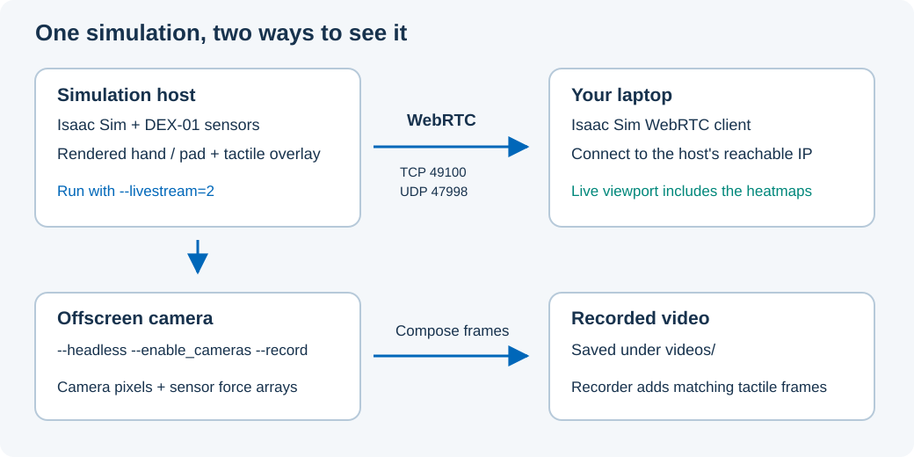

# Author and reproduce documentation

This site follows [ADI Doctools](https://analogdevicesinc.github.io/doctools/),
and its [authoring guidelines](https://analogdevicesinc.github.io/doctools/docs_guidelines/).
Harmonic is ADI's current theme name; Cosmic is its former compatible name.

## Local authoring

From the repository root, create a documentation-only environment:

```bash
python3.11 -m venv .venv-docs
source .venv-docs/bin/activate
python -m pip install -r docs/requirements.txt
make -C docs html
python -m http.server 8000 --bind 127.0.0.1 --directory docs/_build/html
```

Open `http://localhost:8000/`. For editing with live reload:

```bash
adoc serve -d docs
```

This requires no Isaac Sim, GPU, CUDA, or simulation LFS files. Generated files
are ignored by Git. Keep documentation dependency upgrades in reviewed PRs.
The pinned ADI release and shared-action commit are intentional; do not replace
them with moving `latest` or `action` references.

Author Markdown with MyST. Use meaningful section labels and toctrees, explicit
units, figures with captions and alt text, and small readable code examples.
Keep standard ADI styling. The HTML target uses Sphinx’s `dirhtml` builder
for directory URLs compatible with ADI’s search result links. Do not set the
theme’s `landing_page` option: it disables search for local documentation content.

Reference pages use curated interfaces and source excerpts rather than runtime
imports. Update them alongside interface changes. License and contribution
files at the repository root remain canonical.

## Media

The README and homepage share `docs/media/dex01-demo.webp`. Capture from the
current PhysX demo and retain its provenance in
`docs/media/README.md`. Keep images below 2 MB and ordinary Git files; the
existing simulation asset LFS rules do not cover documentation media.
Link larger recordings instead of shipping them with the site. Captions must
identify the force units and the fixture used.

## Reproduce the figures

Use the scene-capture utility in the simulation environment:

```bash
python -m pip install scipy rtree matplotlib
MPLBACKEND=Agg python scripts/docs/export_scene.py \
  --output /tmp/dex01-docs-state \
  --steps 240
python scripts/docs/plot_validation.py \
  --hand-report /tmp/dex01-hand.json \
  --output docs/media
```

The scene exporter runs the unchanged hand demo with a local 0.1 kg cube,
exports live PhysX body transforms, verifies five visible fingertip meshes,
checks every frame against its taxel values, and measures the world-space
distance of every taxel to its visible exterior (acceptance: 1 µm). Its manifest
records the source revision and output hashes. It does not advance a second physics engine.
The plotting utility runs the independent hand-report checker before creating
figures. It takes the report from the validation guide and the released NPZ
pattern to generate the force and mapping figures. `docs/media/figures.json`
records input and figure hashes plus the Python, NumPy, and Matplotlib versions.
Repeating generation with identical inputs and plotting versions produces
identical SVG files; axes include the complete impact transient.

## Render the captured scene

The capture can be rendered without advancing physics:

```bash
python scripts/docs/render_scene.py \
  --state /tmp/dex01-docs-state \
  --output /tmp/dex01-docs-render
```

Use the installed Isaac Sim 5.1 environment on its validated R580 driver,
or a separate renderer environment. The figures in this repository were
rendered with **Isaac Sim 6.0.1.0 / Python 3.12**, using the captured 5.1 physics
state and force arrays. To reproduce that renderer setup without changing the
simulation environment:

```bash
uv venv --python 3.12 --seed .venv-render
.venv-render/bin/python -m pip install \
  "isaacsim[all,extscache]==6.0.1.0" \
  --extra-index-url https://pypi.nvidia.com
.venv-render/bin/python scripts/docs/render_scene.py \
  --state /tmp/dex01-docs-state \
  --output /tmp/dex01-docs-render
```

The first renderer launch requires accepting NVIDIA's Omniverse license.
A supervising process checks the worker's exit, image dimensions, and output
hashes before accepting the render. The camera worker keeps the timeline
stopped and verifies every captured rigid-body transform. It produces a hand
view, a close-up of the loaded fingertip, the matching tactile composite, and a
render manifest. Camera, lighting, and neutral ground shading affect
presentation only; force values come from the captured 5.1 scene.

Keep large scene exports and recordings outside the repository. Once a camera
capture is checked, copy its optimized WebP into `docs/media/`, record physics
and renderer versions in the provenance, and inspect every fingertip, the
loaded object, and all five frame labels before accepting it.

## Reproduce example videos

Capture the actual source examples in the installed simulation environment:

```bash
python scripts/docs/capture_examples.py \
  --example flat-pad --output /tmp/dex01-examples/flat-pad
python scripts/docs/capture_examples.py \
  --example hand --output /tmp/dex01-examples/hand
python scripts/docs/capture_examples.py \
  --example stationary-press --output /tmp/dex01-examples/stationary-press
```

These utilities record the live rigid-body poses and tactile arrays after each
selected physics step. They also save the original body scales and mesh
vertices in `geometry.npz` before replacing any USD transforms. PhysX poses
contain only translation and rotation; preserve the accumulated scale when
applying them to meshes under scaled spawn wrappers. The source examples run
unchanged. The press capture
checks its original report and paces the hold interval for its observed-duration
acceptance; physics timesteps, targets, and forces are unchanged.

In the isolated renderer environment, install the video encoder and render:

```bash
.venv-render/bin/python -m pip install imageio-ffmpeg==0.6.0
.venv-render/bin/python scripts/docs/render_examples.py \
  --capture /tmp/dex01-examples/stationary-press \
  --output /tmp/dex01-example-media/stationary-press
```

Repeat the render command for `flat-pad` and `hand`. It outputs native-camera
videos in WebM and MP4, posters, before/contact/after images, phase captions,
and a hash manifest. The renderer checks each body pose and scale, and compares
every mesh vertex with the original physical geometry at every frame (1 µm
tolerance). A capture without geometry evidence must be recaptured. Hand clips
include a second native camera close-up of the gear. The renderer never advances
physics. Pose and force interpolation are disabled.
Slow playback is labeled: flat-pad 3× slower, press 2× slower, hand at simulation
speed. Each clip uses one force scale and unchanged taxel-to-pixel mapping.

Copy videos, captions, posters, and phase images into `docs/_static/videos/`,
and update `docs/media/examples.json` with both capture
and render evidence. Keep assets below 2 MB each so repository checks and
page loading remain fast. Use controls and `preload="none"` to let the reader
choose when to load/play a clip; phase captions are available through CC, and
the burned-in header states the phase even when captions are disabled.

## Record a simulation

For a live view from another computer, use the
[remote viewing setup](docs/getting-started/installation.md#view-a-remote-simulation).
To save a run for review or sharing, activate the installed simulation
environment, install `ffmpeg`, and run from the repository root:

```bash
MPLBACKEND=Agg python scripts/dex01_on_tesollo_dg5f.py \
  --headless \
  --enable_cameras \
  --record \
  --video-dir ./videos
```

The default gear scene needs NVIDIA asset-server access and an RTX-capable
GPU with the validated R580 driver for Isaac Sim 5.1.0. Expected output is a
video under `videos/` containing the rendered hand and corresponding tactile
heatmaps. Offscreen cameras exclude Kit UI; the recorder composes its own
heatmaps from sensor arrays. Use `--local-plot` on a local desktop for the
optional separate live plot.



The diagram distinguishes a streamed viewport from camera pixels composed
with tactile frames for a saved recording. To generate compact, verified
walkthroughs for the site, follow [example video reproduction](#reproduce-example-videos).

## Authoring checks

Run `make -C docs html` before review: Sphinx warnings fail the build. Check
internal navigation and GitHub README links as well as rendered pages. Run
`make -C docs linkcheck` separately to check external links.
