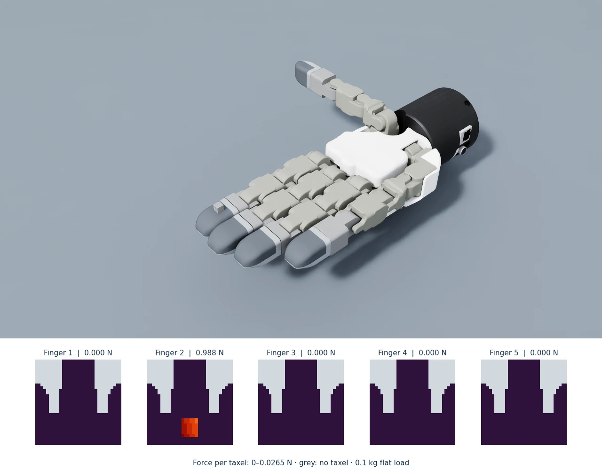

# DEX-01 Tactile Sensor

**Tactile contact simulation for NVIDIA Isaac Lab.** A physically scaled DEX-01
fingertip on the Tesollo DG-5F hand and a rectangular tactile finger on the
official Robotiq 2F-85 gripper, with normal-force sensing in 32 × 32 images.



*A 0.1 kg cube loads finger 2. The tactile frames report physical normal
force in newtons. [Figure provenance](docs/media/README.md).*

[](https://github.com/analogdevicesinc/dex-01-sim-assets/actions/workflows/ci.yml)
[](https://analogdevicesinc.github.io/dex-01-sim-assets/)
[](https://docs.isaacsim.omniverse.nvidia.com/5.1.0/)
[](LICENSE)

[**Documentation**](https://analogdevicesinc.github.io/dex-01-sim-assets/) ·
[Installation](docs/getting-started/installation.md) ·
[**Watch the examples**](docs/examples/index.md) ·
[API reference](docs/reference/api.md) ·
[Model behavior](docs/concepts/limitations.md)

## What you can do

- Read **740 humanoid-fingertip samples** or **1,024 rectangular samples** as a **32 × 32 force frame**.
- Explore contact on a Tesollo hand or a flat pad, with live tactile heatmaps,
  remote WebRTC viewing, and camera recordings.
- Check normal-force balance with a known **0.981 N** load and run geometry,
  contact, and mapping verification.
- Run the [Robotiq 2F-85 integration](docs/examples/robotiq.md) with two tactile
  fingers, using the official Isaac Sim articulation.

The model queries the counter object's PhysX signed distance field and
redistributes measured normal contact load across penetrating samples,
following [TacSL](https://arxiv.org/abs/2408.06506). Output is physical normal
force in newtons, verified against known loads and force balance.

## Quick start

Tested on **Linux x86_64**, **Python 3.11**, **Isaac Sim 5.1.0**, GLIBC 2.35+,
and the Isaac Lab revision pinned by `setup_env.sh`. A supported NVIDIA GPU
and driver are required. For Isaac Sim 5.1 camera/viewport rendering, use
NVIDIA’s validated Linux **580.65.06 (R580)** driver. Install Git, Git LFS, GCC,
G++, Make, and
[uv](https://docs.astral.sh/uv/getting-started/installation/); allow tens of
gigabytes of disk space.

```bash
git clone https://github.com/analogdevicesinc/dex-01-sim-assets.git
cd dex-01-sim-assets
git lfs install
git lfs pull
./setup_env.sh
source ../env_isaaclab/bin/activate
python scripts/dex01_on_tesollo_dg5f.py
```

Wait for `Setup complete...`. A gear contacts fingers 2–5 in turn while the
viewport shows their loads and tactile frames. Stop with Ctrl+C. Initial setup
may request NVIDIA's EULA, download extensions, and compile shaders.

See [installation options](docs/getting-started/installation.md),
[remote viewing](docs/getting-started/installation.md#view-a-remote-simulation), and
[known-load validation](docs/validation.md). The gear is not a calibration load.

## Contribute and license

Read [CONTRIBUTING.md](CONTRIBUTING.md) for development checks and required DCO
sign-offs. Documentation authoring is covered in the
[authoring guide](DOCUMENTATION.md).

ADI-authored material uses [Apache-2.0](LICENSE). Isaac Lab adaptations and
Tesollo geometry retain BSD-3-Clause terms in [NOTICE](NOTICE) and
[LICENSE_Tesollo](LICENSE_Tesollo). Demos fetch the gear from NVIDIA's asset
server under NVIDIA's terms; it is not redistributed here.

## Citation

If you use this repository in your work, please cite it as:

```bibtex
@misc{analogdevices2026dex01,
  author       = {{Analog Devices, Inc.}},
  title        = {{DEX-01 Tactile Sensor Simulation Asset}},
  year         = {2026},
  howpublished = {GitHub repository},
  url          = {https://github.com/analogdevicesinc/dex-01-sim-assets}
}
```

Include the commit hash or release tag you used for reproducibility.
