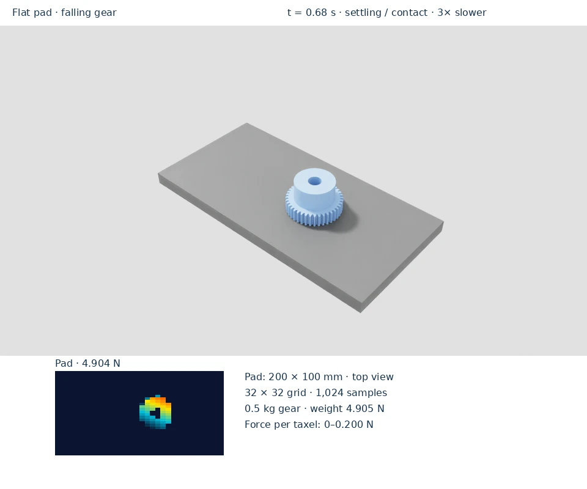
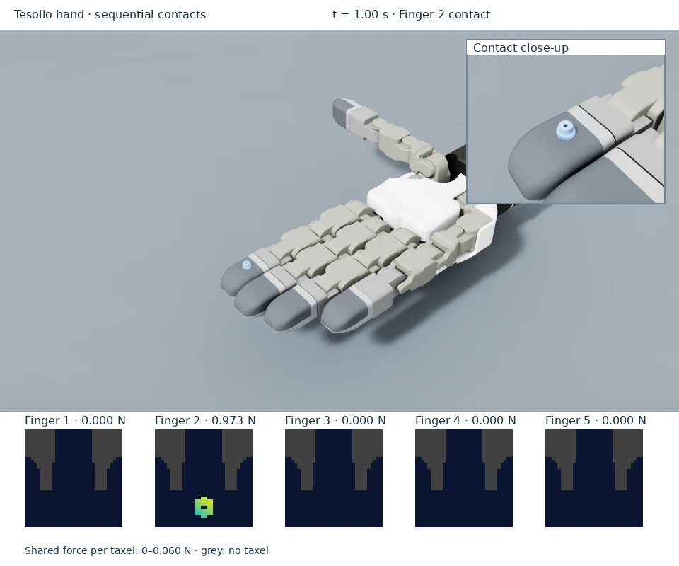
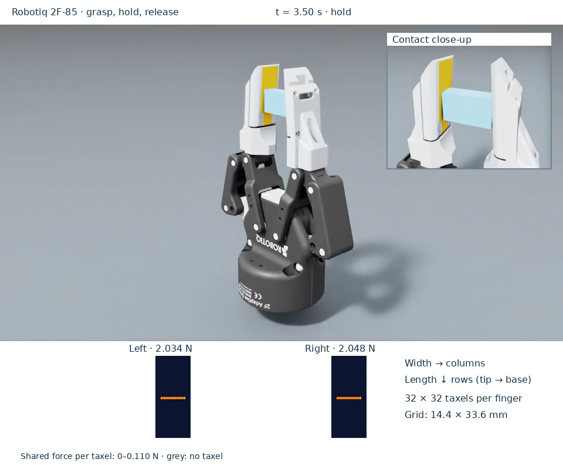

# Overview

Choose an embodiment, then a contact scenario. Each scenario includes a video,
a command to run it, and guidance for reading its tactile output.

<a href="embodiments/flat-pad/"><strong>Flat pad</strong>Falling-object contact on a planar sampling grid.</a>
<a href="embodiments/tesollo-hand/"><strong>Tesollo hand</strong>Sequential fingertip contact and stationary-object pressing.</a>
<a href="embodiments/robotiq-2f85/"><strong>Robotiq 2F-85</strong>Grasp, hold, and release with two rectangular tactile fingers.</a>

## Before running a scenario

Complete [installation](../getting-started/installation.md), including Git LFS
assets, and run commands from the repository root in that environment. The
examples load NVIDIA assets and need access to the configured asset library.
The first command on each page opens a local viewport; for remote viewing,
follow the [streaming setup](../getting-started/installation.md#view-a-remote-simulation).

## Read the tactile display

Each colored cell reports normal force per taxel in newtons. The label above
a frame gives its total normal load. Blue means zero load; cyan, yellow, and
red indicate increasing force. Grey marks pixels without a sensing site.
Use the displayed scale when comparing colors: the live viewport adapts its
scale to the load, while each recorded clip uses one fixed scale.

The flat pad's heatmap is a top view. The hand's frames unwrap curved
fingertips, and the gripper's frames represent its two rectangular contact
faces. See [reading tactile data](../guides/read-data.md) for array access and
[taxel patterns](../guides/patterns.md) for mapping conventions.

The videos replay captured Isaac Sim poses and tactile arrays at the labeled
playback speed. The camera view and tactile frame correspond to the same
simulation step. [Recording provenance](https://github.com/analogdevicesinc/dex-01-sim-assets/blob/main/docs/media/README.md)
contains the capture and rendering details.
