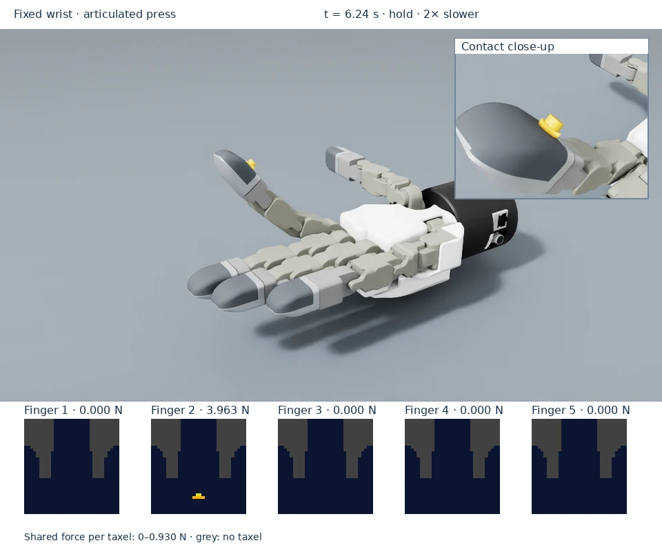

# Explore the examples

Choose the scene that matches what you want to learn. Each page includes a
short video, expected behavior, the command to run it, and how to interpret
its tactile output.

<a href="flat-pad/"><strong>Start with a flat pad</strong>See a contact footprint form as a falling gear settles.</a>
<a href="hand/"><strong>Explore all five fingertips</strong>Follow sequential contacts and compare loaded and unloaded fingers.</a>
<a href="stationary-press/"><strong>Watch articulated pressing</strong>Connect joint movement with contact, force, and release.</a>
<a href="streaming-recording/"><strong>View and share a run</strong>Stream the viewport to a laptop or save a recording with tactile frames.</a>

| Example | Main idea | Expected output |
|---|---|---|
| [Flat pad](flat-pad.md) | Grid sensing and a gravity load | 32 × 32 frame; gear load near 4.905 N |
| [Tesollo hand](hand.md) | Firmware-mapped fingertip contact | Loaded finger's frame active; other frames zero |
| [Stationary press](stationary-press.md) | Articulation creates contact | Fixed wrist/object; finger motion; hold and release |
| [Streaming and recording](streaming-recording.md) | View or share the result | Live viewport on a laptop or a video with tactile frames |

The videos use actual captured Isaac Sim 5.1 poses and tactile arrays,
rendered separately with native RTX cameras. Slow playback is labeled in the
clip. The force frames preserve their exact pixel mapping and share one scale
within each clip; grey indicates unused cells.
Hand videos include a second native camera view of the contact so the small
gear remains legible while the overview shows all five fingertips.
