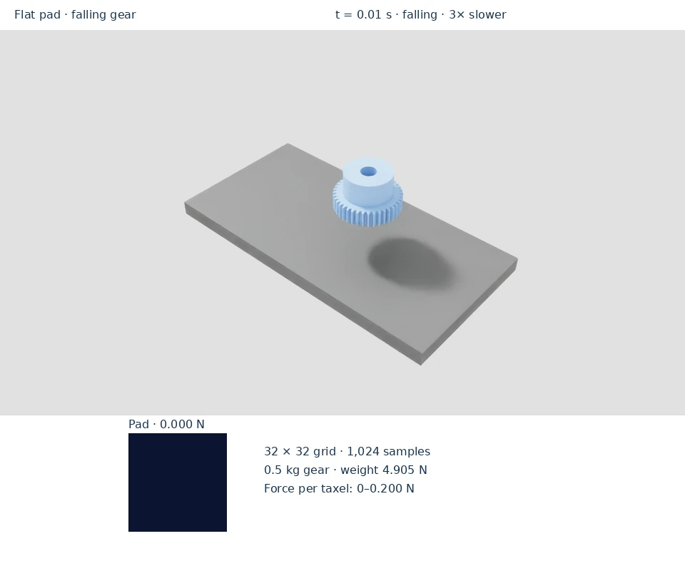
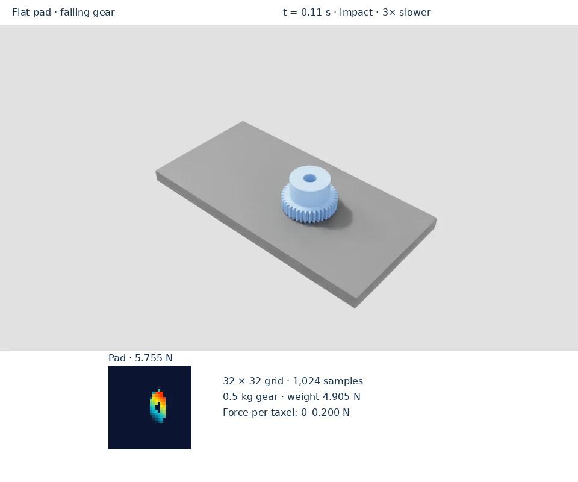
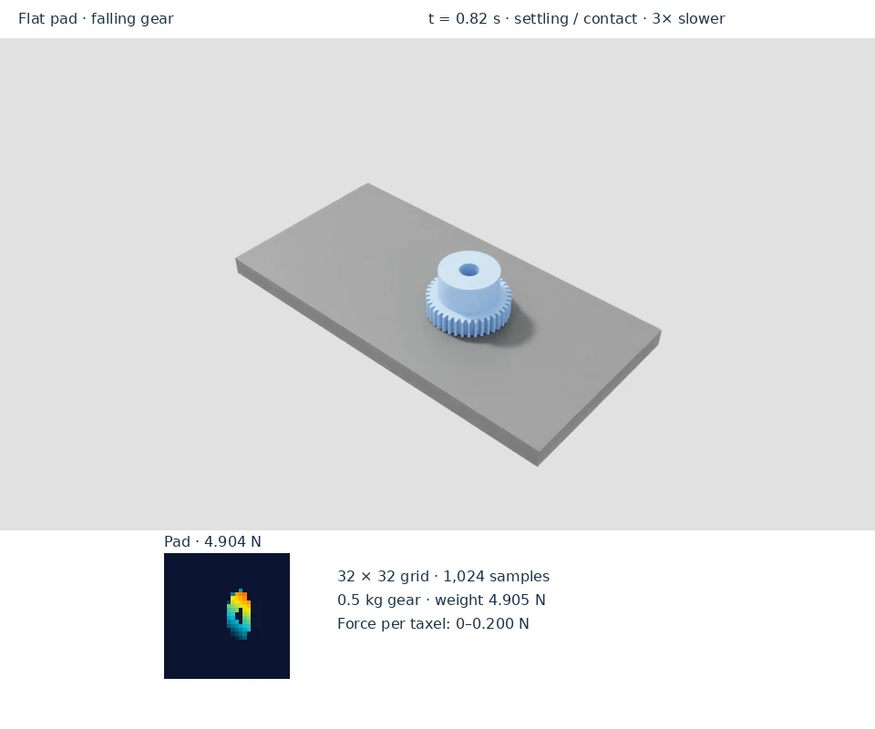

# Flat-pad example

The video and existing example commands on this page use **PhysX**.
The Newton section describes the corresponding workflow and its differences.

Watch the gear drop onto a flat sensing grid. The contact footprint appears
as the load rises, then the total force settles near the gear's weight.
The heatmap is a top view of the 200 × 100 mm pad, displayed at its physical
2:1 aspect ratio. Its 32 columns follow the long axis and its 32 rows the short
axis; the taxel values and pixel mapping are unchanged.

<figure class="example-video">
<video controls playsinline loop preload="none" width="960" height="800"
       poster="../../_static/videos/flat-pad.webp"
       aria-label="Actual flat-pad drop and settling, shown 3× slower. The camera and tactile grid come from the same captured simulation steps.">
  <source src="../../_static/videos/flat-pad.webm" type="video/webm">
  <source src="../../_static/videos/flat-pad.mp4" type="video/mp4">
  <track kind="captions" src="../../_static/videos/flat-pad.vtt" srclang="en" label="Phases">
  <a href="../../_static/videos/flat-pad.mp4">Download the example video</a>
</video>
<figcaption>Actual flat-pad drop and settling, shown 3× slower. The camera and tactile grid come from the same captured simulation steps.</figcaption>
</figure>

<div class="phase-gallery">
<figure><figcaption><strong>Before contact</strong><span>The grid starts unloaded.</span></figcaption></figure>
<figure><figcaption><strong>Impact and contact</strong><span>A localized footprint develops.</span></figcaption></figure>
<figure><figcaption><strong>Settled load</strong><span>The load approaches 4.905 N.</span></figcaption></figure>
</div>

## Run the example

Prerequisites: the [installed environment](../installation.md).
Run from the repository root. This scene downloads a gear from NVIDIA’s
asset server on first use. Run the simpler scene for a broader view of object contact footprints:

```bash
python scripts/simple_example.py
```

The viewport shows a flat sampling grid and live tactile images. Sample
markers are enabled by default. Use `--no-tactile-ui` to hide the overlay.
The pixel arrangement belongs to the grid pattern; it is distinct from the
curved DEX-01 firmware layout. See [patterns](../guides/patterns.md).

For an automated DEX-01 contact sweep and a known-load fixture, use the
[validation commands](../validation.md).

For a bounded smoke check without a window:

```bash
MPLBACKEND=Agg python scripts/simple_example.py --headless --max-steps 120
```

The scene uses a 32 × 32 grid (1,024 samples) on a flat pad and a 0.5 kg gear.
It drops and resets the object every 100 steps and prints peak taxel force and
total load. At 60 steps, the checked run reported about 0.1735 N peak taxel
force and 4.9035 N total load, close to the gear's 4.905 N weight. Transient
readings vary during impact and reset.

This example demonstrates grid sensing. The curved DEX-01 has 740 occupied
firmware pixels; use its 0.1 kg flat-indenter fixture for the quantitative
[known-load verification](../validation.md).

## Newton single fingertip

Newton's `--mode sensor` spawns the curved DEX-01 fingertip, not the 200 × 100 mm
flat grid in the video. It uses 738 taxels in the firmware frame; the flat-grid
4.905 N result does not apply. From the pinned Newton Lab checkout:

```bash
uv run --frozen python /path/to/dex-01-sim-assets/scripts/dex01_newton.py --mode sensor --indenter sphere --max-steps 240
uv run --frozen python /path/to/dex-01-sim-assets/scripts/verify_dex01_newton.py --sweep-all --report /tmp/newton-sweep.json
```

The sweep tests separation, touching and two indentation depths at every taxel,
with analytic sphere-depth and environment-isolation checks. `GridPatternCfg`
is supported by the Newton sensor API, but there is no Newton equivalent of
`simple_example.py`'s flat-grid scene. See [patterns](../guides/patterns.md)
for configuring a custom grid.
