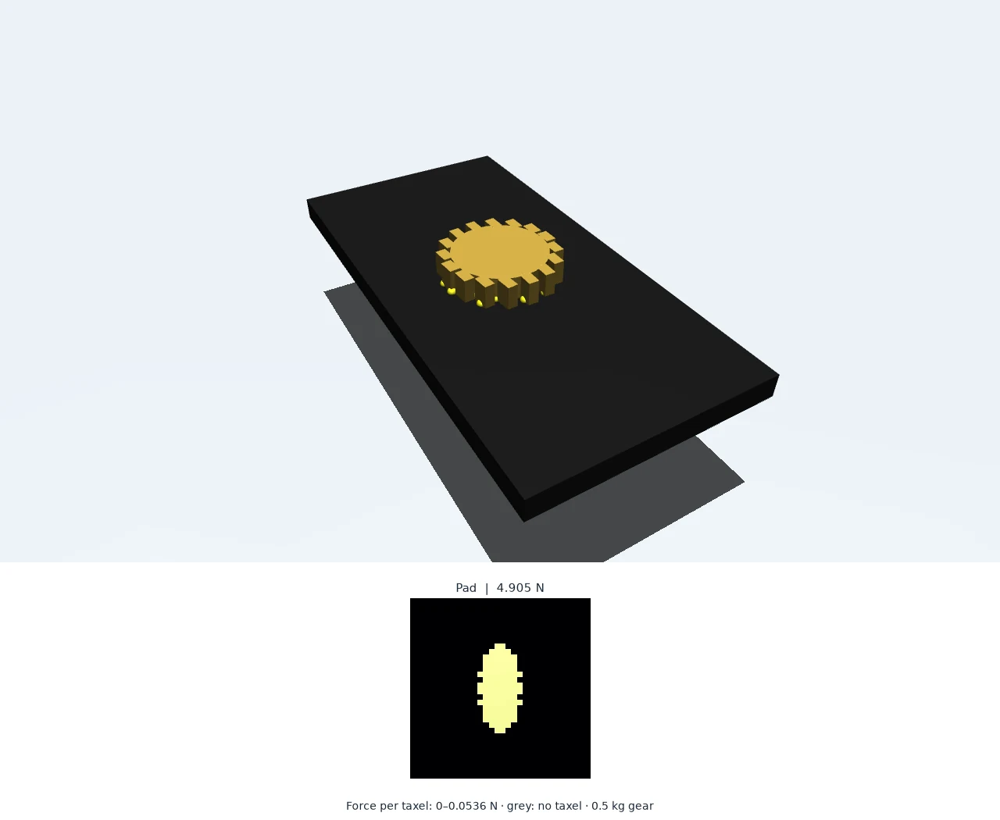
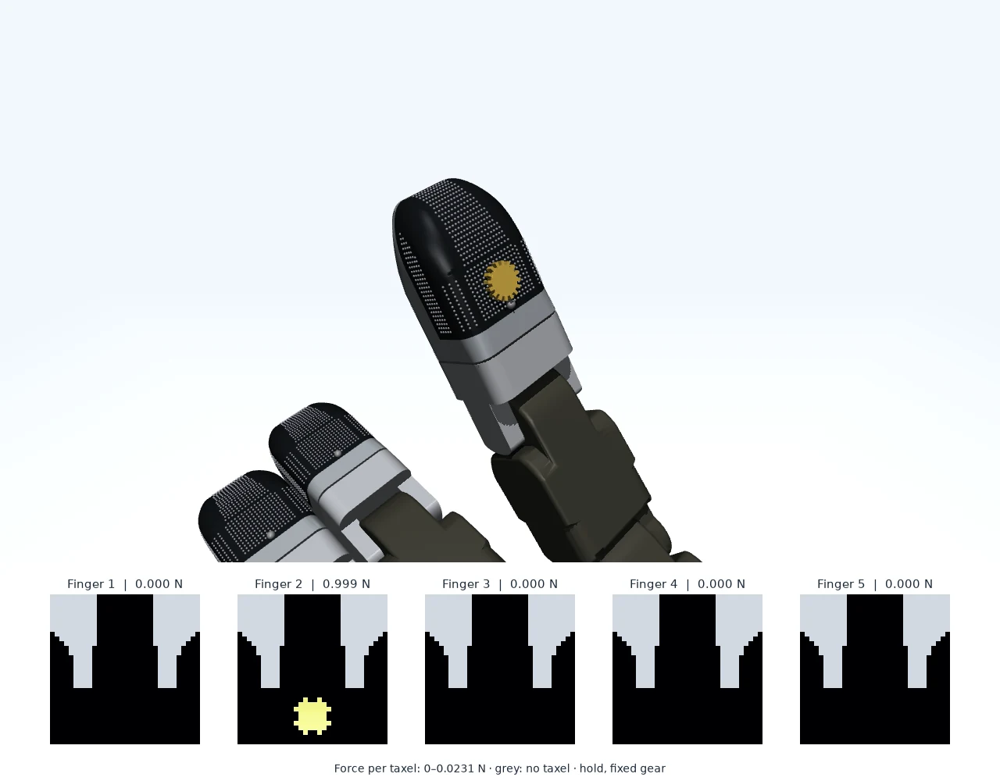
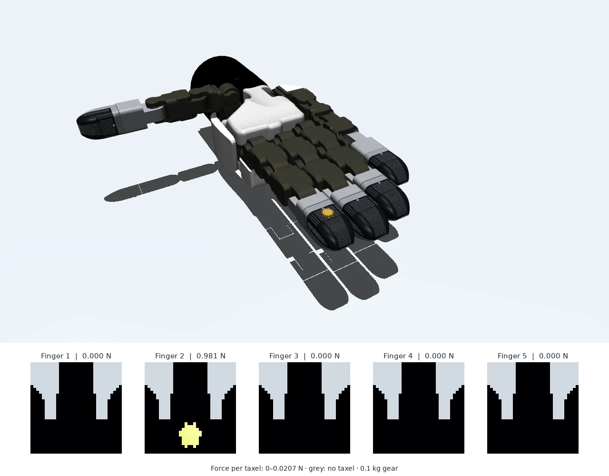

# MuJoCo examples

MuJoCo ports of the Isaac Lab examples. No Isaac Sim, Isaac Lab, or NVIDIA GPU is required.

## Setup

```bash
git lfs pull
uv venv --python 3.11 ../env_dex01_mujoco
source ../env_dex01_mujoco/bin/activate
uv pip install -e source/dex01_mujoco
```

The DG-5F + DEX-01 hand MJCF is generated from `assets/robots/tesollo/dg5f_right.usda`
(fingertip variant `dex01`) on first use and cached in `assets/robots/tesollo/mjcf/`.

## Examples

| Script | Scene | Expected output |
|---|---|---|
| `simple_example.py` | 0.5 kg gear dropped on a flat 32 x 32 pad | Settled total 4.905 N |
| `dex01_on_tesollo_dg5f.py` | 0.1 kg gear rests on fingers 2-5 in turn (`--flat-indenter` for a 6 mm cube) | Loaded finger 0.981 N, others 0 |
| `dex01_stationary_press.py` | Finger 2 articulates against a fixed gear | Hold load near `--press-force-n` (1 N), 0 after release |

Each opens the MuJoCo viewer (taxels drawn as spheres, coloured by force) and a heatmap window
of the firmware frames. Add `--headless --max-steps N` for a non-interactive run.

| Flat pad | Stationary press |
|---|---|
|  |  |
| 0.5 kg gear settled on the 32 x 32 pad: 4.905 N. | Finger 2 in the hold phase against the fixed gear: about 1 N. |



## Figures

`--figure PATH` saves an offscreen render with the five (or one) tactile frames on a shared force
scale at `--figure-time` seconds of simulation time; with `--headless` the run stops there. The
figures in `docs/media/mujoco-*.webp` were made with MuJoCo 3.17.0 by:

```bash
export MUJOCO_GL=egl  # offscreen rendering without a display
python scripts/mujoco/dex01_on_tesollo_dg5f.py --headless --figure docs/media/mujoco-hand.webp
python scripts/mujoco/simple_example.py --headless --figure docs/media/mujoco-flat-pad.webp
python scripts/mujoco/dex01_stationary_press.py --headless --figure docs/media/mujoco-press.webp
```

## Differences from the Isaac Lab model

- The sensor model is the same: the counter object's SDF gives taxel penetration depths, and the
  measured net contact force is resolved along the depth-weighted normal and redistributed by depth.
- MuJoCo has no point SDF query, so `dex01_mujoco.sdf` evaluates analytic SDFs of the counter
  body's collision geoms (primitives exactly; meshes as their convex hull, which is what MuJoCo
  collides with). The DEX-01 overmold is convex to within 0.2% by volume, so its hull collider is faithful.
- NVIDIA's Factory gear is not redistributable; the gear here is built from a cylinder and box teeth.
- Joint servos keep the Isaac `kp = 200` but use `kd = 5` with 0.01 kg m^2 armature; Isaac's
  `damping = 80` with MuJoCo's armature model lags the targets by about 0.4 s.
